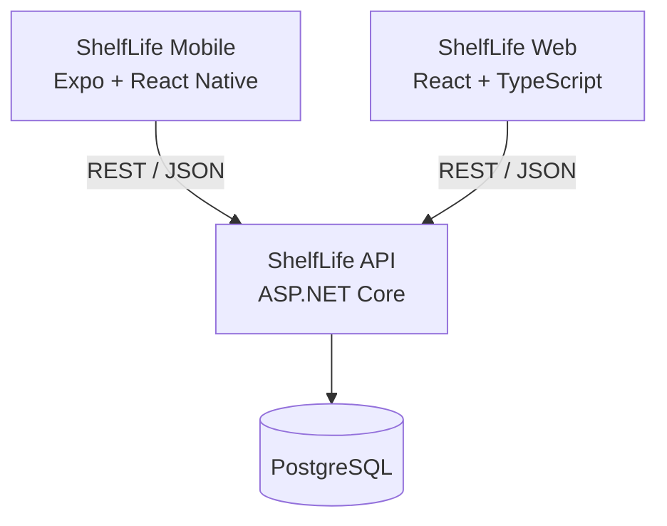

# ShelfLife Mobile

<div align="center">

**Your kitchen, in sync.**

A mobile grocery inventory app for keeping track of food, checking expiry dates and making a little less waste at home.


</div>

ShelfLife is built around a simple idea: keeping track of food at home should not be another complicated task. The app gives you one place to record what you have, where you keep it and when it should be used.

This repository contains the Expo and React Native mobile client. It connects to the same [ShelfLife API](https://github.com/ZinhleHlongwane/ShelfLife-API) used by the [web application](https://github.com/ZinhleHlongwane/ShelfLife-WebApp).

## What I built

The current mobile app supports the main inventory workflow:

- Load inventory records from the API.
- Add food with a name, quantity, unit, expiry date and storage area.
- Edit existing items.
- Delete items after confirming the action.
- Filter the list by fridge, pantry or freezer.
- See the total inventory count and items expiring within the next three days.
- See loading, empty and API error states.
- Validate food names, quantities and calendar dates before sending requests.

When an item is added, edited or deleted, the change is sent to the API. It is not just stored in the phone's temporary screen state. The web app can retrieve the same records from that backend.

## How it fits together



The mobile app is responsible for the mobile interface and user interaction. The API handles inventory operations and persistence. Both clients use the same request and response contract.

## A few implementation details

### API communication

The inventory API service contains the HTTP operations for listing, creating, updating and deleting items. It also handles unsuccessful responses and connection errors so the screen can show useful feedback.

### Calendar dates

Expiry dates are sent as `YYYY-MM-DD` values. The mobile app converts those date-only values into local calendar dates instead of interpreting them as UTC timestamps. This avoids an expiry date unexpectedly moving to the previous or next day because of timezone conversion.

### Device-specific API addresses

The app uses `EXPO_PUBLIC_API_BASE_URL` to determine where the API is running. The default `10.0.2.2` address is intended for the standard Android emulator, not a physical phone.

## Technology

| Area | Technology |
|---|---|
| Mobile framework | React Native 0.81 |
| Development platform | Expo SDK 54 |
| Language | TypeScript |
| API communication | Fetch API, REST and JSON |
| Backend | ASP.NET Core / .NET 10 |
| Persistence | PostgreSQL |
| CI | GitHub Actions |

## Run locally

### Requirements

- Node.js 22 or later
- npm
- Expo Go on a supported phone, or an Android/iOS simulator
- The [ShelfLife API](https://github.com/ZinhleHlongwane/ShelfLife-API) running with PostgreSQL

### 1. Clone and install

```bash
git clone https://github.com/ZinhleHlongwane/ShelfLife-MobileApp.git
cd ShelfLife-MobileApp
npm install
```

### 2. Configure the API address

The app reads `EXPO_PUBLIC_API_BASE_URL`. If it is not set, the default is `http://10.0.2.2:5000`.

| Where the app runs | Example API address |
|---|---|
| Android emulator | `http://10.0.2.2:5000` |
| iOS simulator | `http://localhost:5000` |
| Physical phone using Expo Go | `http://YOUR_COMPUTER_LAN_IP:5000` |

For a physical phone, the phone and computer need to be on the same Wi-Fi network. Use the computer's private LAN IPv4 address instead of `localhost`.

Create a local `.env` file in the project root to override the default:

```env
EXPO_PUBLIC_API_BASE_URL=http://10.0.2.2:5000
```

Start PostgreSQL and the API by following the instructions in the ShelfLife API repository.

### 3. Start Expo

```bash
npx expo start
```

Follow the Expo CLI instructions to open the app in a simulator or Expo Go.

### 4. Run the TypeScript check

```bash
npm run typecheck
```

GitHub Actions runs this TypeScript validation on pushes and pull requests to `main`.

## Project structure

```text
src/
├── components/       # Food item cards
├── features/
│   └── inventory/    # Inventory display and domain helpers
├── models/           # Food item and API-aligned types
├── screens/          # Main inventory screen
├── services/         # API client
└── utils/            # Expiry-date helpers
```

## Current limitations

- Authentication and household-specific permissions are not implemented in the API yet.
- Offline caching and synchronisation are not implemented. The app needs to reach the API to load and change inventory.
- Barcode scanning, recipe suggestions, shopping lists and push notifications are future work.
- The app has not yet been verified in a live physical-device session. The API integration and TypeScript workflow are in place, but device-specific networking and UI behaviour still need to be tested.

Do not expose the development API publicly or use it for real household data until authentication, authorisation and household-level data isolation are implemented.

## What's next

- [x] Connect the mobile inventory screen to the shared API.
- [x] Add create, read, update and delete operations.
- [x] Add storage filters and expiry indicators.
- [x] Add API error handling and input validation.
- [x] Add TypeScript validation in GitHub Actions.
- [ ] Verify the app on Android and iOS devices.
- [ ] Add automated component and API-client tests.
- [ ] Implement authentication and household accounts.
- [ ] Add offline-aware inventory synchronisation.
- [ ] Explore barcode lookup and expiry reminders.

---

Built by [Zinhle Hlongwane](https://github.com/ZinhleHlongwane) · Johannesburg, South Africa 🇿🇦
