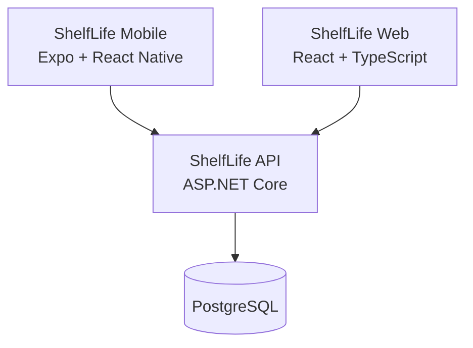

# ShelfLife Mobile

**A React Native application for managing grocery inventory and reducing household food waste.**

ShelfLife Mobile is the mobile client in the ShelfLife application suite. It shares inventory data with [ShelfLife Web](https://github.com/ZinhleHlongwane/ShelfLife-WebApp) through the [ShelfLife ASP.NET Core API](https://github.com/ZinhleHlongwane/ShelfLife-API).

## Current features

- Load shared inventory from the ASP.NET Core API
- Add food items with quantity, measurement unit, expiry date and storage category
- Edit existing inventory records
- Delete inventory records
- Filter inventory by fridge, pantry and freezer
- Display expiry status and days remaining
- Show loading, empty, validation and API error states
- Confirm destructive delete actions

Changes made in the mobile app are persisted by the API and are available to the web client using the same backend.

## Architecture



## Technology

| Area | Technology |
|---|---|
| Mobile framework | React Native 0.81 |
| Development platform | Expo SDK 54 |
| Language | TypeScript |
| API communication | REST / Fetch API |
| Backend | ASP.NET Core / .NET 10 |
| Database | PostgreSQL |

## Run locally

### Prerequisites

- Node.js 22 or later
- npm
- Expo Go on a supported phone, or an Android/iOS simulator
- The ShelfLife API running locally with its PostgreSQL database

### Install and start

```bash
npm install
npx expo start
```

### Configure the API address

The mobile app reads `EXPO_PUBLIC_API_BASE_URL`. It defaults to `http://10.0.2.2:5000`, which is the host-machine address from the standard Android emulator.

Set the environment variable to match the environment where the API is running:

| Environment | Example API URL |
|---|---|
| Android emulator | `http://10.0.2.2:5000` |
| iOS simulator | `http://localhost:5000` |
| Physical phone using Expo Go | `http://YOUR_COMPUTER_LAN_IP:5000` |

For a physical phone, the phone and computer must be on the same network. Use your computer's private LAN IPv4 address, not `localhost`. Keep the API bound to an interface reachable by the phone and allow the port through the computer firewall.

Create a local `.env` file in the project root if you need to override the default:

```env
EXPO_PUBLIC_API_BASE_URL=http://10.0.2.2:5000
```

Start PostgreSQL and the API by following the setup instructions in the [ShelfLife API repository](https://github.com/ZinhleHlongwane/ShelfLife-API).

## Inventory API

The mobile client uses the shared endpoints:

| Method | Endpoint | Purpose |
|---|---|---|
| GET | `/api/inventory` | Load inventory |
| POST | `/api/inventory` | Add an item |
| PUT | `/api/inventory/{id}` | Update an item |
| DELETE | `/api/inventory/{id}` | Delete an item |

Expiry dates are sent as date-only `YYYY-MM-DD` values to avoid timezone shifts. Measurement units and storage categories use the API's enum values.

## Project structure

```text
src/
├── components/
│   └── FoodCard.tsx
├── features/
│   └── inventory/
│       ├── inventoryDisplay.ts
│       └── inventoryLogic.ts
├── models/
│   └── FoodItem.ts
├── screens/
│   └── InventoryScreen.tsx
├── services/
│   └── inventoryApi.ts
└── utils/
    └── dateHelpers.ts
```

## Current limitations

- Authentication and household-specific access are not implemented in the API yet.
- Barcode scanning, recipe suggestions, shopping lists and push notifications remain planned.
- Offline caching and conflict resolution are not implemented.
- The mobile client has not yet been verified in a live device session.

Do not expose the development API publicly or use it for real household data until authentication, authorisation and production security controls are implemented.

## Roadmap

- [x] Connect mobile inventory listing to the shared API
- [x] Add create, update and delete operations
- [x] Add storage filters and expiry indicators
- [ ] Add automated component and API-client tests
- [ ] Add authentication and household accounts
- [ ] Add offline-aware inventory synchronisation
- [ ] Add barcode scanning
- [ ] Add expiry notifications
- [ ] Add recipe suggestions and shopping lists
- [ ] Add mobile screenshots and a verified device demo

---

Built by [Zinhle Hlongwane](https://github.com/ZinhleHlongwane) · Johannesburg, South Africa
